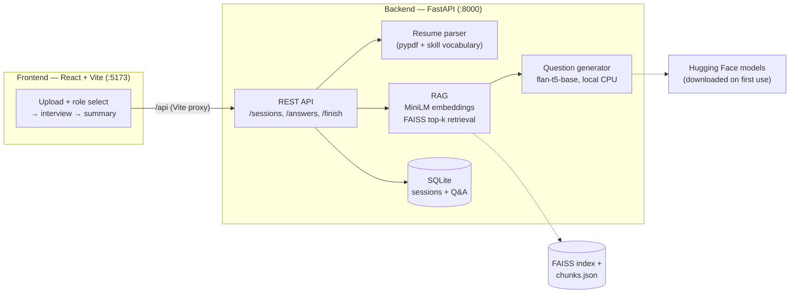

# InterviewLens

AI-powered role-based candidate screening: resume in → RAG over ML
textbooks → interview questions generated by a local model → interactive
interview → SQLite-persisted Q&A → heuristic summary.

> **Demo video:** [`demo/interviewlens-demo.mp4`](demo/interviewlens-demo.mp4)
> (~2 min, 1920×1080, narrated with burnt-in subtitles). Every frame is a
> real screen capture of the running app (Playwright, 10 Nov 2026) — no
> mock-ups. The voice is synthetic (espeak-ng); the narration describes
> only what is actually shown. Raw screenshots:
> [`demo/screenshots/`](demo/screenshots/).

## What it does

1. Upload a resume (`.pdf` or `.txt`) and pick a role.
2. The backend parses the resume, extracts skills, and retrieves relevant
   passages from the textbooks for that role (FAISS over MiniLM embeddings).
3. A local `google/flan-t5-base` model generates **five interview
   questions**, each grounded in a retrieved passage and labelled with its
   source book (e.g. “Grounded in: Bishop — Pattern Recognition and
   Machine Learning”).
4. Answer the questions in the browser; answers are saved per question.
5. Finish to get a summary: topics covered, strengths/gaps. The summary
   is a **basic heuristic** (answer length + keyword overlap with the
   source material) — it is not a score and not a hiring decision.

## Roles (knowledge base = the provided ML books only)

| Role | Books |
|---|---|
| `ai_ml` — AI/ML Engineer | Mitchell, Burkov, Bishop, Brownlee |
| `data_science` — Data Science / Applied ML Engineer | Intro to ML with Python, Brownlee, ML for Absolute Beginners, Burkov |

There is **no Backend Engineer role**: the provided books cover ML only,
so no knowledge base could be honestly built for it.

## Quick start

### Prerequisites

- Python 3.12 (backend venv already ships the deps; see below)
- Node.js 20+ (frontend; tested with Node 24)
- The books in `books/` (see [Knowledge base](#knowledge-base)) and a
  built vector store in `data/vectorstore/` — both are **not** in git.
  First run downloads the two Hugging Face models (see
  [Models](#models)).

### 1. Backend (FastAPI, port 8000)

```bash
cp .env.example .env          # no secrets in here; adjust paths if needed
python3 -m venv .venv
.venv/bin/pip install torch --index-url https://download.pytorch.org/whl/cpu
.venv/bin/pip install -r backend/requirements.txt
.venv/bin/python backend/ingest.py        # builds data/vectorstore/ from books/
.venv/bin/python -m uvicorn backend.app:app --host 0.0.0.0 --port 8000
```

Health check: `GET http://localhost:8000/api/health` →
`{"status":"ok","roles":[...],"chunks":5959}`

### 2. Frontend (React + Vite, port 5173)

```bash
cd frontend
npm install
npm run dev                   # http://localhost:5173, /api proxied to :8000
# production build:
npm run build
```

### Environment variables (`.env`)

| Variable | Default | Purpose |
|---|---|---|
| `DATABASE_URL` | `sqlite:///data/interviewlens.db` | SQLite session/Q&A store |
| `VECTORSTORE_DIR` | `./data/vectorstore` | FAISS index + `chunks.json` |
| `EMBEDDING_MODEL` | `sentence-transformers/all-MiniLM-L6-v2` | Retrieval embeddings |
| `GENERATION_MODEL` | `google/flan-t5-base` | Question generation |
| `CORS_ORIGINS` | `http://localhost:5173` | Allowed frontend origin |

## Architecture



Full endpoint contract: [`API_CONTRACT.md`](API_CONTRACT.md).

## Knowledge base

Chunks counted from `data/vectorstore/chunks.json` (verified 10 Nov 2026):

| Book | Chunks |
|---|---|
| Bishop — Pattern Recognition and Machine Learning | 2,298 |
| Mitchell — Machine Learning (OCR text — scanned PDF, no text layer) | 1,715 |
| Müller & Guido — Introduction to Machine Learning with Python | 928 |
| Burkov — The Hundred-Page Machine Learning Book | 402 |
| Brownlee — Master Machine Learning Algorithms | 344 |
| Bonaccorso — Machine Learning for Absolute Beginners | 272 |
| **Total** | **5,959** |

Notes:

- Mitchell is a scanned PDF: OCR it with `books/ocr_mitchell.sh`
  (pdftoppm + tesseract) into `books/mitchell-ocr.txt`; `ingest.py`
  picks it up automatically and skips Mitchell with a log line when the
  OCR text is absent.
- `books/ai-ml-dl.pdf` was an HTML error page, not a book — removed.
- Ingestion drops table-of-contents / front-matter chunks so retrieval
  returns teachable content, not book furniture.
- The books themselves are **not committed** (copyrighted material) —
  see `.gitignore`. `data/` (SQLite DB + vector store) is not committed
  either; rebuild it with `backend/ingest.py`.

## Models (local, CPU, downloaded from Hugging Face on first use)

- Embeddings: `sentence-transformers/all-MiniLM-L6-v2`
- Question generation: `google/flan-t5-base`

**Hard rule:** every question comes from the flan-t5 model prompted with
retrieved textbook context. There is no template fallback: if the model
cannot produce a valid, on-topic question, the API returns HTTP 503.
Generated questions are validated (must read like a question, must
contain a topic keyword, must not be a generic “about the book/position”
question) and retried against other retrieved chunks before giving up.

## Design decisions

- **flan-t5-base, local, instead of a hosted LLM API.** No API key, no
  per-call cost, no resume text leaving the machine, and the whole demo
  runs offline after the first model download. The trade-off is question
  quality (see [Limitations](#limitations)): a 250M-parameter model on
  CPU writes modest questions, not expert-crafted ones.
- **MiniLM (`all-MiniLM-L6-v2`) + FAISS for retrieval.** A small, fast
  embedding model (384-dim) that runs on CPU in milliseconds, paired
  with a local FAISS index — no vector-DB server to run. Retrieval is
  top-k per query (k=3, deduplicated) over 5,959 textbook chunks, which
  is small enough that exact search is cheap.
- **SQLite for persistence.** Sessions, answers, and summaries are a
  handful of relational rows; SQLite is zero-config, single-file, and
  needs no server. The DB lives at `data/interviewlens.db`.
- **Only two roles (`ai_ml`, `data_science`).** Roles are defined by
  their textbook knowledge base, and the six provided books only cover
  ML / applied ML. Adding a role without books behind it would mean
  questions grounded in nothing, so the role list stops where the books
  stop.
- **React + Vite, plain CSS, no component library.** The UI is three
  screens (upload → interview → summary); a heavier framework would add
  nothing. The Vite dev server proxies `/api` to the backend so the
  frontend needs no backend URL configuration.
- **Summary is a labelled heuristic, not a score.** Answer quality is
  judged only by length and keyword overlap with the source chunk. The
  UI says so explicitly; inventing a numeric score would be dishonest.

## Verification evidence (10 Nov 2026, all run live)

- **Backend health:** `GET /api/health` →
  `{"status":"ok","roles":["ai_ml","data_science"],"chunks":5959}`.
- **Full browser flow, `ai_ml` role** (Playwright, real resume
  `AKTUIITP2_O__1__2_ncym.pdf`, script in
  [`demo/record-demo.mjs`](demo/record-demo.mjs), log in
  [`demo/session-log.json`](demo/session-log.json)): roles loaded from
  the API with no fallback warning; resume selected (58.3 KB); session
  created in **30.4 s** on the first run and **33.6 s** on the rerun;
  5 questions answered; summary rendered “5 of 5 questions answered”.
  Run twice with the same result. Questions observed (they vary run to
  run — flan-t5 is stochastic):
  - “What is the supervised learning theory about?” — Bishop
  - “What is the difference between a model and a decision tree?” — Burkov
  - “What is the most important factor that determines the learning rate
    of neural networks?” — Bishop
  - “What is the model evaluation process?” — Mitchell
  - “What is a supervised learning algorithm?” — Mitchell
- **“Grounded in” line:** the backend returns `source` as a plain
  string (e.g. `"Bishop — Pattern Recognition and Machine Learning"`)
  and the frontend renders it verbatim — confirmed in the screenshots
  and in the summary Q&A record.
- **`data_science` role — full API end-to-end verified:** `POST
  /api/sessions` with `role=data_science` returned a session
  (`33953a1f-fc5b-46da-a883-b7360aa961e1`) with 5 questions and 15
  retrieved chunks, all sourced from its own book set (Müller & Guido,
  Brownlee, Burkov); all 5 answers were stored (HTTP 200) and
  `POST /finish` returned the summary (5 of 5 answered, 3 topics
  covered). **Not verified:** the `data_science` role was not driven
  through the browser UI (the UI flow was verified with `ai_ml`).
- **Bug found and fixed during the integration test:** skill chips were
  rendered twice — the resume parser returns overlapping `skills` and
  `technologies` lists (e.g. Python in both), and React logged
  duplicate-key warnings. Fixed by de-duplicating in
  `frontend/src/App.jsx`; verified by a clean rerun with no console
  errors.
- **Frontend build:** `npm run build` passes (17 modules, 229.6 kB JS).
- **Demo video:** built from the real screenshots with ffmpeg; verified
  with `ffprobe` (1920×1080, h264 + aac) and by inspecting extracted
  frames — every frame is a genuine capture of the app.

## Limitations (honest)

- **Question quality is modest.** flan-t5-base questions are on-topic
  and grounded, but phrased generically (“What is the most important
  factor in supervised learning?”, “What is the model evaluation
  process?”). They read like textbook prompts, not like questions a
  senior interviewer would ask. A larger model would do better; that
  would also need a GPU or a hosted API.
- **Session creation takes ~30–35 s on CPU** (measured 30.4 s, 33.6 s,
  34.1 s on this machine — five flan-t5 generations). It is slower on
  weaker hardware; there is no streaming or progress beyond a spinner.
- **The summary is a heuristic, not an evaluation.** Strengths/gaps
  come only from answer length and keyword overlap. Short but correct
  answers can be missed; long off-topic answers can look strong.
- **Skill extraction is vocabulary matching**, not NER: only skills in
  the curated list are recognised, and resume skills not in the list are
  silently ignored.
- **Retrieval is only as good as the six books.** Topics outside them
  (system design, backend engineering, current frameworks) have no
  grounding and no role.
- **No authentication, no multi-user separation.** Sessions are
  identified by an unguessable UUID in the URL path; anyone with the ID
  can read a session. Fine for a demo, not for production.
- **Questions vary between runs** (sampling in generation), so the exact
  questions in the demo video will not reproduce byte-for-byte.

## Repository structure

```
.
├── README.md                  # this file
├── API_CONTRACT.md            # backend ↔ frontend endpoint contract
├── .env.example               # config template (no secrets)
├── resume.pdf                 # test resume used for the demo run
├── backend/
│   ├── app.py                 # FastAPI app + endpoints
│   ├── config.py              # roles, books, env config
│   ├── db.py                  # SQLite persistence
│   ├── generate.py            # flan-t5 question generation + validation
│   ├── ingest.py              # PDF/OCR → chunks → FAISS index
│   ├── rag.py                 # MiniLM embeddings + retrieval
│   ├── resume.py              # resume parsing + skill extraction
│   └── requirements.txt
├── frontend/                  # React + Vite (npm run dev → :5173)
│   ├── src/App.jsx            # upload → interview → summary UI
│   ├── src/api.js             # thin API client
│   └── vite.config.js         # /api proxy to localhost:8000
├── demo/
│   ├── interviewlens-demo.mp4 # narrated demo video (real captures)
│   ├── screenshots/           # raw Playwright screenshots
│   ├── record-demo.mjs        # Playwright driver (integration test + capture)
│   ├── build-video.sh         # screenshots + espeak-ng narration → mp4
│   └── session-log.json       # questions/sources/summary from the demo run
├── books/                     # NOT in git — the six ML textbooks + OCR text
└── data/                      # NOT in git — SQLite DB + FAISS vector store
```
